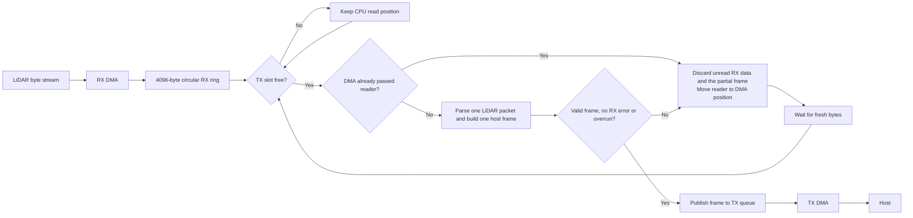
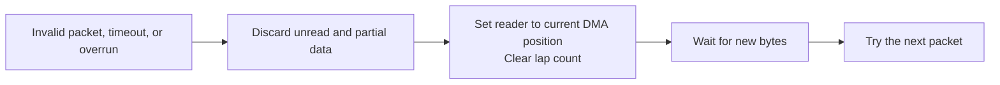
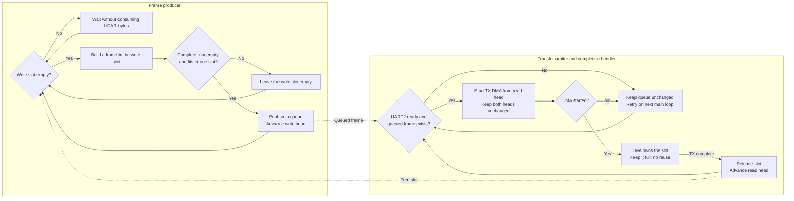

## Scan path

The main loop gives ready IMU and encoder samples priority over LiDAR parsing.
The diagram below shows the LiDAR path when a TX slot is available.



RX DMA continues while all TX slots are busy. The CPU read position stays
unchanged. Once a slot is free, the main loop checks whether DMA passed the reader
before it consumes more bytes.

One LiDAR packet produces one host frame. The payload format is defined in
[frame.md](frame.md#lidar-frame-payload).

## RX ring positions

`write_idx` is the next DMA destination. `read_idx` is the next byte for the
CPU. The CPU never reads the current DMA destination.

```text
index       0                                             4095
            |-----------------------------------------------|
DMA         W -> next write
CPU                         R -> next read
```

The current read guard leaves the two newest received bytes unread.
A byte is readable only when `(write_idx - read_idx) mod 4096 > 2`.
The indexes are signed, so `100 - 3500 = -3400` stays negative before the
ring calculation.


`lap` counts DMA wraps that the reader has not crossed yet. DMA increments it
at the ring end. The reader decrements it when its index returns to zero.

| `lap` | Index relation | Result |
| ---: | --- | --- |
| 0 | Any valid indexes | DMA has not passed the reader |
| 1 | `write_idx <= read_idx` | DMA has not passed the reader |
| 1 | `write_idx > read_idx` | DMA passed the reader |
| 2 or more | Any valid indexes | DMA passed the reader |

## RX recovery

### Invalid packet, timeout, or overrun

LiDAR reads have a 40 ms deadline measured from the start of frame parsing.
Each byte read also has a 20 ms wait limit. Successful reads do not extend the
frame deadline. These time limits are separate from the two-byte read guard.

If parsing fails, times out, or detects an overrun, the main loop drops the
partial frame and all unread RX data. It moves the reader to the current DMA
position and clears the lap count.



Recovery starts from bytes that arrive after alignment. It does not wait for
another full ring wrap. Frames already published to the TX queue stay queued.

### UART4 or RX DMA error

The UART4 error callback requests recovery. The main loop aborts the remaining
RX transfer, resets the RX ring, and restarts circular DMA.
It discards the partial frame and retries on the next loop if abort or restart
fails. Host communication and queued TX frames continue.
The controller does not resend the LiDAR start command.

## Host command RX

Startup uses blocking UART transfers. After `START SCAN ACK`, the controller
arms one 4-byte UART2 receive buffer using interrupts before starting LiDAR DMA.

The receive callback checks the command, updates valid motor outputs, and arms
the next receive before returning. It does not wait for the main loop.
Motor commands can run while LiDAR parsing waits for data.

 The exchange is described in
[protocol.md](protocol.md#motor-commands).

## TX queue

One host frame uses one TX slot from construction until transmission completes.
This lifecycle applies to sensor frames during scanning. Startup system messages
use blocking UART TX and reuse a free slot without publishing it to this queue.

### Frame lifecycle



### Queue heads

| Head | Who advances it | When it advances |
| --- | --- | --- |
| Write head | Frame producer | After publishing one complete frame |
| Read head | Completion handler | After DMA finishes reading one frame |

```text
            read head             write head
                |                     |
                v                     v
+---------+---------+---------+---------+---------+
| slot 0  | slot 1  | slot 2  | slot 3  | slot 4  |
| EMPTY   | READY   | READY   | EMPTY   | EMPTY   |
+---------+---------+---------+---------+---------+
```

In this example, the producer builds a frame in slot 3 and advances the write
head to slot 4 when it publishes the frame. The arbiter starts DMA from slot 1
without moving either head. DMA completion releases slot 1 and advances the read
head to slot 2.

### Capacity

| Item | Largest size |
| --- | ---: |
| One LiDAR packet with one-byte LSN | `10 + 3 * 255 = 775` bytes |
| One host LiDAR frame | `14 + 4 * 255 = 1034` bytes |
| One TX slot | 1344 bytes |
| Number of TX slots | 5 |

```text
TX storage: 6720 bytes
+-----------------+-----------------+-----------------+-----------------+-----------------+
| slot 0: 1344 B  | slot 1: 1344 B  | slot 2: 1344 B  | slot 3: 1344 B  | slot 4: 1344 B  |
+-----------------+-----------------+-----------------+-----------------+-----------------+
0                1344              2688              4032              5376              6720

Largest frame: [header 14 B][255 points x 4 B][unused 310 B]
```

One slot can be transmitting while four complete frames wait. The payload arrays
use 6720 bytes. The full queue object uses 6764 bytes after metadata and alignment.


## LiDAR-only throughput at 230400 bps

| Quantity | Calculation | Result |
| --- | ---: | ---: |
| LiDAR point rate | configured ranging rate | 4000 points/s |
| Host point payload | `4000 * 4` | 16000 bytes/s |
| UART capacity with 8N1 | `230400 / 10` | 23040 bytes/s |
| Remaining capacity | `23040 - 16000` | 7040 bytes/s |

The largest 775-byte LiDAR packet takes about 34 ms on the wire.
At a 6 Hz scan rate, one rotation carries about 667 points. Its host point payload
is about 2667 bytes, while the UART can send 3840 bytes in the same interval.
This leaves about 1173 bytes for 14-byte host headers, or a theoretical maximum
of 83 LiDAR packets per rotation. This estimate excludes IMU and encoder traffic.
Actual packet count and TX queue occupancy must be measured before using this limit.

More slots absorb a short burst. They do not increase the sustained UART rate.
