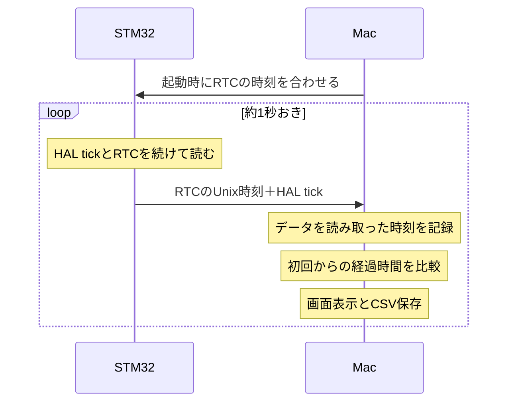

# RTCの時刻ずれを観測する

時刻同期の通信仕様と計算は [time_sync.md](time_sync.md) を参照。

`codex/rtc-hal-clock-measurements` の `main.c` は、UART2で時刻同期を1回行った後、
約1秒ごとにRTCのUnixミリ秒とHAL tickを送る観測用の起動になっている。
通常の `loop()` 呼び出しはコメントアウトしている。LiDARの起動やモーター指令の受信は行わない。
`time_sync.c` のHAL tickで時刻を進める別案はコメントアウトしてあるため、RTCとHAL tickを別々に観測できる。
測定結果は、現在のRTCとSysTickの固定補正を適用した状態の値になる。

## 測定の仕組み

STM32がRTCとHAL tickを約1秒おきに送り、Macが自分の時計で測った経過時間と比較する。
最初の時刻同期でRTCの日時をMacに合わせるが、HAL tickは起動後のカウンタのまま使う。
測定中は、MacからRTCの時刻を合わせ直したり、測定値に応じて固定補正を変更したりしない。



STM32は、送信フレームのヘッダにRTCのUnixミリ秒を、本文に `CLOCK tick_ms=N\r\n` を載せる。
Macは、UARTからデータを読み取った直後に次の2種類の時計を記録する。

| Macの時計 | 使い道 |
| --- | --- |
| Unix時刻 | RTCと現在の日時を比較する |
| 単調時計 | 初回からの経過時間を測る。OSによる日時の調整を経過時間に混ぜない |

Macは最初の観測サンプルを基準に、毎回次の値を計算する。時間の単位はすべてミリ秒。

```text
Macの経過時間 = 今回のMac単調時計 - 初回のMac単調時計
RTCの経過時間 = 今回のRTC値 - 初回のRTC値
HALの経過時間 = 毎回のHAL tickの差を合計（32bitの周回を考慮）

RTC drift = RTCの経過時間 - Macの経過時間
HAL drift = HALの経過時間 - Macの経過時間
offset    = 今回のRTCのUnix時刻 - 今回のMacの受信Unix時刻
```

例えばMacで60090.232ms、HAL tickで60120ms経過したなら、
`HAL drift = 60120 - 60090.232 = +29.768ms`。HAL tickが約30ms余分に進んだことを表す。
初回のdriftが0なのは初回を基準にしたためで、同期誤差が0という意味ではない。

STM32が送信前にRTCを読み、Macが転送後に受信時刻を記録するため、
`offset` にはUART・USB・OSの処理による遅れも入る。
例えば `offset = -9ms` だけでは、RTC自体が9ms遅れているとは判断できない。
driftでは初回との差を取るため、毎回一定の転送遅延は相殺されるが、遅延の変動はばらつきとして残る。
RTCの読み取りは現在約3.9ms刻みなので、短い測定の数msの差だけで細かい補正量を決めない。

送信間隔をHALのDelayで作っていても、この比較は成立する。
Macは受信回数を1秒として数えず、自分の時計で実際の経過時間を測るため、HAL tickが速ければその差が現れる。
UART転送や処理時間もあるので、送信間隔そのものは正確な1秒ではない。

## 実行方法

1. `make build` でビルドし、ファームを書き込む。
2. 基板をリセットする。UART2は230400 baudで、Macのほかの受信プログラムは閉じておく。
3. Macでリポジトリのルートから実行する。

```bash
python3 tools/clock.py
```

USBモデムが1台なら自動で選ぶ。複数ある場合は `--port /dev/cu.usbmodemXXXX` を指定する。
Pythonの標準ライブラリだけで動く。デフォルトは60秒で、Ctrl+Cでも終了できる。
実行し直す前には基板をリセットする。

CSVは実行日時を含む `/tmp/sensor-echo-clock-YYYYmmdd-HHMMSS.csv` に新規保存する。
既存ファイルは上書きしない。`--seconds 120` や `--output /tmp/clock.csv` でも変更できる。

| 列 | 意味 |
| --- | --- |
| `host_unix_ms` | Macでフレームを受信した時刻 |
| `rtc_unix_ms` | ファームがフレームに載せたRTCの時刻 |
| `offset_ms` | RTC − Macの受信時刻。正ならRTCが進んでいる |
| `host_elapsed_ms` | 最初のサンプルからのMacの経過時間。単調時計で計算する |
| `rtc_elapsed_ms` | 最初のサンプルからRTCが進んだ時間 |
| `rtc_drift_ms` | RTCの経過時間 − Macの経過時間 |
| `tick_ms` | ファームがRTCと一緒に読んだHAL tick |
| `tick_elapsed_ms` | HAL tickの経過時間。32bitの周回も考慮する |
| `tick_drift_ms` | HAL tickの経過時間 − Macの経過時間 |

`rtc_drift_ms` が増え、`tick_drift_ms` がほぼ増えなければ、RTC側の進み方が原因と考えられる。
例えばMacで10秒の間にRTCが10.5秒進むなら、RTCのずれは約+500msになる。
`offset_ms` には初回同期の誤差とUART転送・Macの受信処理の遅れも含まれるため、
1回の値より、時間がたつにつれてどの程度増えるかを見る。

## 保存した実測値

測定したCSVを [clock/](clock/) に保存している。以下は各CSVの最終サンプルの値。
前半は設定を変えながら測った履歴で、このブランチの設定は最終行に対応する。
各サンプルのdriftは最初のサンプルを基準にしており、初回同期の時刻差を含まない。

| 測定日時（JST）・CSV | 測定時の設定 | サンプル数 | Mac経過時間 | RTC drift | HAL drift |
| --- | --- | ---: | ---: | ---: | ---: |
| [10/21 23:28:07](clock/sensor-echo-clock-20261021-232807.csv) | LSI、分周127 / 249、補正なし | 27 | 25.937108s | +1506.892ms | +114.892ms |
| [10/21 23:29:35](clock/sensor-echo-clock-20261021-232935.csv) | LSI、分周127 / 249、補正なし | 15 | 13.960121s | +767.879ms | +68.879ms |
| [10/21 23:35:50](clock/sensor-echo-clock-20261021-233550.csv) | LSI、分周127 / 255、補正なし | 19 | 17.959007s | +548.993ms | +76.993ms |
| [10/21 23:40:32](clock/sensor-echo-clock-20261021-234032.csv) | LSE、分周127 / 255、補正なし | 17 | 15.960116s | +0.884ms | +71.884ms |
| [10/21 23:51:21](clock/sensor-echo-clock-20261021-235121.csv) | LSE、分周127 / 255、補正なし | 62 | 60.809185s | +3.815ms | +312.815ms |
| [10/22 11:57:09](clock/sensor-echo-clock-20261022-115709.csv) | LSE、RTC補正21、SysTick未補正 | 62 | 60.902089s | -0.089ms | +220.911ms |
| [10/22 12:04:20](clock/sensor-echo-clock-20261022-120420.csv) | LSE、RTC補正21、SysTick未補正 | 15 | 13.976145s | +0.855ms | +51.855ms |
| [10/22 12:09:00](clock/sensor-echo-clock-20261022-120900.csv) | LSE、RTC補正21、SysTick補正3712ppm | 61 | 60.090232s | -1.232ms | +29.768ms |

RTCの補正21は、10/21 23:51:21の `RTC drift` をMac経過時間に対して直線近似した
約+19.6ppmを基にしている。32秒で21パルスを除くと約20ppm遅くなる。
HAL tickの補正3712ppmは、10/22 11:57:09の測定で、全測定時間の半分以上離れた
サンプルの組ごとにdriftの傾きを求め、その中央値（約+3712.1ppm）を使った。
これらは複数サンプルから決めた値なので、最終サンプルだけから換算したppmとは一致しない。

最終測定ではMacで約60.09秒の間に、RTC driftは-1.232ms、HAL driftは+29.768msだった。
RTCの約3.9msの読み取り間隔と通信遅延のばらつきがあるため、RTCの小さな残差からさらに細かい補正は決めていない。
