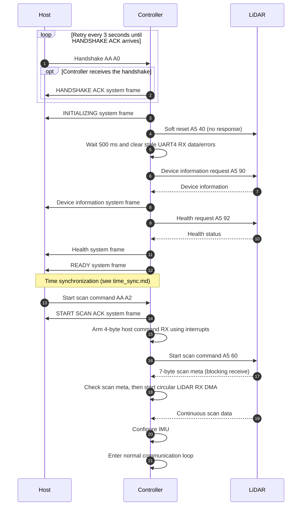
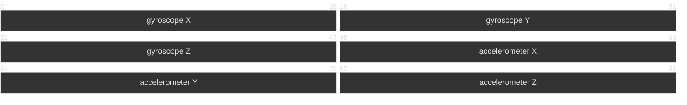
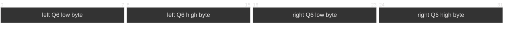

# Startup Sequence

Startup uses blocking UART transfers. During scanning, LiDAR reception and host
frame transmission use DMA. Host motor commands use UART receive interrupts.

The host sends a handshake every 3 seconds until it receives `HANDSHAKE ACK`.
Initialization starts after this exchange. For protocol errors and recovery,
see [protocol.md](protocol.md#connection-and-recovery).

The diagram shows the normal startup path. `MOTOR ACK` and host recovery during
normal communication are planned. For the clock-observation entry point, see
[clock.md](clock.md).



Soft reset is the first LiDAR command, followed by a 500 ms restart wait.
Device information and health checks run before scanning. The LiDAR
manual allows only the stop command during scanning. After `A5 60`, the controller
receives exactly seven meta bytes with blocking UART and checks the response mode
and type. It then switches immediately to circular RX DMA for scan data. The meta
check does not wait for additional scan bytes in the DMA ring.
The controller sends `START SCAN ACK` after it accepts the host command and
before it starts RX DMA. The ACK confirms the host command only. It does not
confirm DMA startup, the `A5 60` UART transfer, or a LiDAR response.

If UART communication or reply validation fails, the controller sends a
`STARTUP FAILED` system frame when possible and returns to the handshake stage.
The host retries the handshake, then repeats startup and time synchronization
before starting a new scan.

Failures while sending `A5 60`, receiving or validating scan meta, or starting DMA
also report their stage. These failures stop the protocol via `Error_Handler()`.

The failure payload includes the startup stage. UART failures also include the
UART number, operation, HAL status, and the original `ErrorCode` bits, for example:
`STARTUP FAILED: lidar info: UART4 RX HAL_TIMEOUT error=0x00000000`.
The frame type remains `0x08`; the payload is text without a trailing NUL.

## Host-to-Controller Commands

These messages have no terminator. Handshake, Start scan, and Time sync start
are two-byte commands. Time appends two timestamps. Motor control
appends two one-byte signed PWM percentages, left first and then right.

The controller accepts `Time` only after it has acknowledged `Time sync start`.
During normal communication, it receives fixed 4-byte motor frames only.

| Message | Wire data (first → last) | Size | Accepted stage |
|---|---|---:|---|
| Handshake | `0xAA 0xA0` | 2 bytes | Startup: wait for handshake |
| Start scan | `0xAA 0xA2` | 2 bytes | Startup: wait for start command |
| Time sync start | `0xAA 0xA4` | 2 bytes | Startup: time sync |
| Time | `0xAA 0xA5` → **`ack_time`** → **`send_time`** | 18 bytes | Startup: after time-sync start ACK |
| Motor control | `0xAA 0xA7` → **left PWM %** → **right PWM %** | 4 bytes | Normal communication |

`Handshake` is a connection request, not a heartbeat. The host stops its
3-second retry loop after `HANDSHAKE ACK`. A new handshake during normal
communication is not handled yet; see the planned recovery in
[protocol.md](protocol.md#connection-and-recovery).

### Motor control

The host sends a two-byte command followed by one signed PWM percentage per wheel:

- Direction: host to controller
- Command: `0xAA 0xA7`
- Total size: 4 bytes
- Payload length: `2`
- Payload: left wheel first, then right wheel; one signed 8-bit two's-complement integer each
- Unit: signed PWM duty percentage (`%`)
- Valid range: `0` to `100`, inclusive; forward only
- A two-byte command and its payload only; no TX frame header

The value sets forward PWM duty directly. Negative values are invalid. Each
field is one byte, so it has no byte order.

| Wire order | Byte offset | Field | Size | Format | Unit | Valid range |
|---:|---:|---|---:|---|---|---|
| 1st | `0` | Command | 2 bytes | `0xAA 0xA7` | - | Fixed |
| 2nd | `2` | **Left** motor command | 1 byte | Signed 8-bit two's complement | Forward PWM duty % | `0` to `100` |
| 3rd | `3` | **Right** motor command | 1 byte | Signed 8-bit two's complement | Forward PWM duty % | `0` to `100` |

| Signed value | Direction | PWM duty | Driver behavior |
|---|---|---:|---|
| `1` to `100` | Forward | Value in % | Forward/brake |
| `0` | Stopped | 0% | Brake low |

The [Pololu DRV8835](https://www.pololu.com/product/2135/) uses PHASE/ENABLE
mode: MODE is High, PHASE is Low for forward and High for reverse, and ENABLE
receives PWM. This firmware keeps PHASE Low and does not accept reverse commands.
ENABLE Low brakes the motor. The percentage controls PWM output;
it does not guarantee a measured wheel speed.

The current source applies valid values without sending an ACK. An unknown
command or an out-of-range value is ignored, leaving the previous PWM output
unchanged. `MOTOR ACK`, type `0x0E`, and recovery after invalid commands are
planned. The planned ACK confirms acceptance of both PWM values.

```text
                    HOST -> CONTROLLER: MOTOR CONTROL
byte offset   0      1      2      3      4
              +------+------+------+------+
              |  AA  |  A7  | left |right |
              +------+------+------+------+
              <-- command --><-- PWM % --->
```

For left `50%` and right `100%`, the payload is `32 64` in hexadecimal. The
complete command is `AA A7 32 64`. Both zero, `AA A7 00 00`, brakes both motors.

### Time synchronization

The exchange, Time command layout, calculation, and report format are described
in [time_sync.md](time_sync.md).

# Tx Frame
|Start of Frame (16bit)  | payload Length (16bit) | CRC (8bit)|Type (8bit)|timestamp (64bit) |  payload   |
|---| ---|---|---|---|---|
|0xAA55|-|-| 0x01  Lidar |-| point data| 
|0xAA55|-|-| 0x02  IMU | -|kinematic data| 
|0xAA55|-|-| 0x03  Encoder |-| left and right wheel rotation data|
|0xAA55|-|-| 0x04  Initializing |-| `INITIALIZING` |
|0xAA55|-|-| 0x05  Device information |-| Device information message |
|0xAA55|-|-| 0x06  Health status |-| Health status message |
|0xAA55|-|-| 0x07  Ready |-| `READY` |
|0xAA55|-|-| 0x08  Startup failed |-| `STARTUP FAILED` |
|0xAA55|-|-| 0x09  Start scan acknowledged |-| `START SCAN ACK` |
|0xAA55|-|-| 0x0A  Time-sync start acknowledged |-| `TIME SYNC START ACK` |
|0xAA55|-|-| 0x0B  Time acknowledged |-| `TIME ACK` |
|0xAA55|-|-| 0x0C  Time-sync report |-| One time-sync measurement |
|0xAA55|-|-| 0x0D  Handshake acknowledged |-| `HANDSHAKE ACK` |
|0xAA55|-|-| 0x0E  Motor command acknowledged |-| `MOTOR ACK` |

The header is 14 bytes. The start-of-frame marker is the fixed byte sequence
`0xAA 0x55`. Payload length and timestamp are little-endian. The payload begins
at `tx_buf + 14`, so it can be written before the header. Payload length counts
payload bytes only. These frames travel from controller to host. The timestamp
is unsigned 64-bit Unix time in milliseconds (UTC), read from the RTC when the
frame is built. Frames sent before time synchronization use the RTC's current
value. CRC and type are one byte each and therefore have no byte order.

| Byte offset | Size | Field |
|---:|---:|---|
| `0` | 2 bytes | Start of frame: `AA 55` |
| `2` | 2 bytes | Payload length |
| `4` | 1 byte | CRC |
| `5` | 1 byte | Type |
| `6` | 8 bytes | Unix timestamp in milliseconds |
| `14` | Payload length | Payload |

### System Message

System message types start at `0x04`; type `0x00` is not used. Their payloads are
ASCII text without a trailing NUL. Most have no line terminator; the time-sync
report ends with CRLF as specified in [time_sync.md](time_sync.md#プロトコル).
The payload starts immediately after the 14-byte TX header. The header payload
length marks the message end.

| Type | Event | Host system message payload |
|---|---|---|
| `0x04` | Startup begins | `INITIALIZING` |
| `0x05` | Device information | `LiDAR DEVICE: model=N firmware=M.m hardware=H serial=XXXXXXXXXXXXXXXXXXXXXXXXXXXXXXXX` |
| `0x06` | Health, status byte `0x00` | `LiDAR STATUS: OK \| code=0x00` |
| `0x06` | Health, status byte above `0x00` | `LiDAR STATUS: FAULT \| code=0xNN` |
| `0x07` | Startup completes | `READY` |
| `0x08` | Startup fails | `STARTUP FAILED` |
| `0x09` | Host start command accepted | `START SCAN ACK` |
| `0x0A` | Time-sync start command accepted | `TIME SYNC START ACK` |
| `0x0B` | One Unix-time sample accepted | `TIME ACK` |
| `0x0C` | Time synchronization completed | Time-sync measurement report |
| `0x0D` | Handshake received | `HANDSHAKE ACK` |
| `0x0E` | Motor values accepted | `MOTOR ACK` |

`INITIALIZING`, device information, and health messages are defined but disabled
in the current startup path. `MOTOR ACK` is defined but not sent yet.

The time-sync report format and field meanings are described in
[time_sync.md](time_sync.md#プロトコル).

The health status is `FAULT` when any bit in the status byte is set. `NN` is the
two-digit uppercase hexadecimal status byte. The device serial is the 16 raw
serial-number bytes in sensor wire order, encoded as 32 uppercase hexadecimal
digits. Model, firmware, and hardware values are unsigned decimal numbers.


### LiDAR frame payload

Size: 4 bytes per point (2 bytes for distance and 2 bytes for angle). The
distance field comes first, followed by the angle field. Each 16-bit field is
little-endian on the wire: its least-significant byte is transmitted first.


The angle value is degrees multiplied by 64; for example, 45.5° is 2912.
Angles rotate clockwise from the LiDAR's zero direction. The encoded range is
0..23039; 360° wraps to zero.

For example, a point at distance 7161 (`0x1BF9`) and angle 10°
(`10 * 64 = 640 = 0x0280`) is transmitted as:

| Byte offset | `0` | `1` | `2` | `3` |
|---:|---:|---:|---:|---:|
| Wire byte | `F9` | `1B` | `80` | `02` |
| Field | distance low | distance high | angle low | angle high |

The same little-endian order is used by the payload length and timestamp in the
frame header. All currently defined multi-byte numeric fields in the host frame
are therefore little-endian.

The RX ring is described in [protocol.md](protocol.md). The TX queue and slot
lifecycle are described in [tx.md](tx.md).


### IMU frame payload

The controller sends the IMU sample buffer directly as the payload.

- Payload size: 12 bytes
- Field order: sensor register order starting at `OUTX_L_G`
- Value format: raw 16-bit two's-complement sample
- Byte order: little-endian; low register byte first
- Unit: sensor LSB
- Conversion: none; the host applies the configured full-scale sensitivity



| Byte offset | Size | Sample | Unit |
|---:|---:|---|---|
| `0` | 2 bytes | Gyroscope X | LSB |
| `2` | 2 bytes | Gyroscope Y | LSB |
| `4` | 2 bytes | Gyroscope Z | LSB |
| `6` | 2 bytes | Accelerometer X | LSB |
| `8` | 2 bytes | Accelerometer Y | LSB |
| `10` | 2 bytes | Accelerometer Z | LSB |

The host can convert gyroscope samples to `dps` and accelerometer samples to
`g` when physical units are needed.

### Encoder Frame payload

Direction: controller to host, type `0x03`.

Size: 4 bytes per sample. Each sample reports the rotation change since the
previous counter reset, not a cumulative position. The target sampling period
is 100 ms (10 Hz) using TIM5. Both encoders use TI12 (four counts per quadrature
cycle), with 2800 counts per wheel revolution and an update after 28000 counts.
The left wheel uses TIM4 and the right wheel uses TIM3. Pending update flags are
included in each snapshot and cleared along with the counters. Reverse encoder
motion is outside the current scope.

The left wheel value comes first, followed by the right wheel value. Each value
is a signed 16-bit Q6 wheel rotation count in two's complement and uses the
same little-endian byte order as the other multi-byte host-frame fields.

| Payload order | Payload offset | Field | Size | Format | Unit | Byte order |
|---:|---:|---|---:|---|---|---|
| 1st | `0` | **Left** wheel rotation count | 2 bytes | Signed 16-bit Q6 | rotations | little-endian |
| 2nd | `2` | **Right** wheel rotation count | 2 bytes | Signed 16-bit Q6 | rotations | little-endian |



Divide the encoded value by 64 to get the wheel rotation count:

\[
\text{wheel rotations} = \frac{\text{Q6 value}}{64}
\]

For example, left wheel `12.5` rotations and right wheel `7.25` rotations are
encoded as `12.5 * 64 = 800 = 0x0320` and
`7.25 * 64 = 464 = 0x01D0`:

| Byte offset | `0` | `1` | `2` | `3` |
|---:|---:|---:|---:|---:|
| Wire byte | `20` | `03` | `D0` | `01` |
| Field | left low | left high | right low | right high |

### CRC
The CRC field uses the 8-bit `crc_8()` function from libcrc. For now, its input
is only the two payload-length bytes at header offsets 2 and 3. Process each
byte most-significant bit first and write the full 8-bit result at offset 4.
The CRC does not currently cover the other header fields or the payload.
LiDAR RX checks are described in [protocol.md](protocol.md#data-checks).

| Parameter | Value |
|---|---|
| Width | 8 bits |
| Polynomial | `x^8 + x^5 + x^4 + 1`, represented as `0x31` without the top bit |
| Initial value | `0x00` |
| Input and output reflection | None |
| Final XOR | `0x00` |
| Check value for ASCII `123456789` | `0xA2` |
