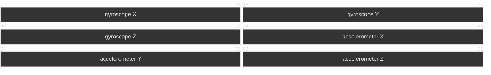
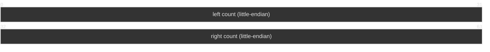

# Frame Format

```text
Host -> Controller (no TX header or terminator)
byte offset  0         2
             +---------+--------------------------------+
             | Command | Payload                        |
             | 2 bytes | Command-specific; may be empty |
             +---------+--------------------------------+

Controller -> Host
byte offset  0         2                4        5        6             14        14 + N
             +---------+----------------+--------+--------+-------------+---------+
             | AA 55   | Payload length | CRC    | Type   | Timestamp   | Payload |
             | 2 bytes | 2 bytes, LE    | 1 byte | 1 byte | 8 bytes, LE | N bytes |
             +---------+----------------+--------+--------+-------------+---------+

Header = 14 bytes; N = payload length; total frame = 14 + N bytes.
LE = little-endian.
```

Frame exchanges and recovery: [protocol.md](protocol.md).
Buffer management: [arbiter.md](arbiter.md).

## Host-to-Controller Commands

| Message | Wire data (first to last) | Size | Accepted stage | Notes |
| --- | --- | ---: | --- | --- |
| Handshake | `AA A0` | 2 bytes | Startup: wait for handshake | Connection request. |
| Start scan | `AA A2` | 2 bytes | Startup: wait for start command | No payload. |
| Time sync start | `AA A4` | 2 bytes | Startup: time sync | No payload. |
| Time | `AA A5` → `ack_time` → `send_time` | 18 bytes | Startup: after time-sync start ACK | Two unsigned 64-bit timestamps; see [Time synchronization](#time-synchronization). |
| Motor control | `AA A7` → left PWM % → right PWM % | 4 bytes | Normal communication | Two signed 8-bit PWM values; left first. |

### Motor control

Motor control is a 4-byte command: `AA A7`, followed by one signed 8-bit PWM
percentage per wheel, left first. The payload is 2 bytes. The command has no TX
header or terminator.

Only forward PWM duty from 0% to 100% is valid. Negative values are invalid.
A value of 0 brakes the wheel. PWM duty sets the output directly; it does not
guarantee a measured wheel speed. Each PWM field is one byte, so it has no byte
order.

| Byte offset | Size | Field | Format | Unit | Valid range |
| ---: | ---: | --- | --- | --- | --- |
| `0` | 2 bytes | Command | `AA A7` | — | Fixed |
| `2` | 1 byte | Left motor command | Signed 8-bit two's complement | PWM duty % | `0` to `100` |
| `3` | 1 byte | Right motor command | Signed 8-bit two's complement | PWM duty % | `0` to `100` |

| Signed value | Direction | PWM duty | Driver behavior |
| --- | --- | ---: | --- |
| `1` to `100` | Forward | Value in % | Forward/brake PWM |
| `0` | Stopped | 0% | Brake low. |

Command handling is described in [protocol.md](protocol.md#motor-commands).
Wiring notes are in [memo.md](../memo.md).

```text
                    HOST -> CONTROLLER: MOTOR CONTROL
byte offset   0      1      2      3      4
              +------+------+------+------+
              |  AA  |  A7  | left |right |
              +------+------+------+------+
              <-- command --><-- PWM % --->
```

For left 50% and right 100%, the payload is `32 64` in hexadecimal, and the
complete command is `AA A7 32 64`. Both zero, `AA A7 00 00`, brakes both motors.

### Time synchronization

Time sync start is the two-byte command `AA A4`.
The Time command has 18 bytes. Each timestamp is an unsigned 64-bit integer
in little-endian order. Neither command has a TX header or an end marker.

| Byte offset | Size | Content |
| ---: | ---: | --- |
| `0` | 2 bytes | `AA A5` |
| `2` | 8 bytes | `ack_time`: host time when the start ACK arrived |
| `10` | 8 bytes | `send_time`: host time just before sending Time |

Both timestamps use Unix milliseconds (UTC).
The exchange and calculation are described in [time_sync.md](time_sync.md).

## Tx Frame

| Byte offset | Size | Field | Format | Notes |
| ---: | ---: | --- | --- | --- |
| `0` | 2 bytes | Start of frame | Fixed bytes `AA 55` | Sent in this order. |
| `2` | 2 bytes | Payload length | Unsigned 16-bit, little-endian | Counts payload bytes only; excludes the 14-byte header. |
| `4` | 1 byte | CRC | Unsigned 8-bit | Covers only the two payload-length bytes; see [CRC](#crc). |
| `5` | 1 byte | Type | Unsigned 8-bit | `0x01`: LiDAR; `0x02`: IMU; `0x03`: Encoder; system types start at `0x04`. Type `0x00` is unused. |
| `6` | 8 bytes | Timestamp | Unsigned 64-bit, little-endian | Unix milliseconds (UTC), read from the RTC when the frame is built. Before time sync, this is the RTC's current value. |
| `14` | Payload length | Payload | Depends on type | Starts after the header. The builder may write the payload before filling in the reserved header. |

### System Message

System message payloads are ASCII text without a trailing NUL byte.
The header payload length marks the message end. Only the time-sync report
ends with `\r\n`.

| Type | Host system message payload | Notes |
| --- | --- | --- |
| `0x04` | `INITIALIZING` | Sent when startup begins. |
| `0x05` | `LiDAR DEVICE: model=N firmware=M.m hardware=H serial=XXXXXXXXXXXXXXXXXXXXXXXXXXXXXXXX` | Sent during startup. Model, firmware, and hardware values are unsigned decimal numbers. Serial is 16 raw bytes in sensor wire order, written as 32 uppercase hex digits. |
| `0x06` | `LiDAR STATUS: OK \| code=0x00` | Sent during startup when the health status byte is zero. |
| `0x06` | `LiDAR STATUS: FAULT \| code=0xNN` | Sent during startup when any status bit is set. `NN` is the two-digit uppercase hex status byte. |
| `0x07` | `READY` | LiDAR information and health checks are complete; time sync follows. |
| `0x08` | `STARTUP FAILED: stage[: UART details]` | Includes the failed stage. UART details include the UART number, operation, HAL status, and original `ErrorCode` bits. Brackets mark optional text and are not sent. |
| `0x09` | `START SCAN ACK` | Host start command accepted. |
| `0x0A` | `TIME SYNC START ACK` | Time-sync start command accepted. |
| `0x0B` | `TIME ACK` | Time command received; time calculation and RTC setup happen later. |
| `0x0C` | Time-sync measurement report | Format below. `samples=1` means one measurement. Field meanings: [time_sync.md](time_sync.md#protocol). |
| `0x0D` | `HANDSHAKE ACK` | Handshake received. |
| `0x0E` | `MOTOR ACK` | Defined but not sent; planned only. |

### LiDAR frame payload

Size: 4 bytes per point (2 bytes for distance and 2 bytes for angle). The
distance field comes first, followed by the angle field. Each 16-bit field is
little-endian on the wire: its least-significant byte is transmitted first.
One host frame carries the points from one LiDAR packet, not one full rotation.
The point count is the payload length divided by 4. The sensor's rotation-start
flag and checksum are not included in the host payload.


The angle value is degrees multiplied by 64; for example, 45.5° is 2912.
Angles rotate clockwise from the LiDAR's zero direction. The encoded range is
0..23039; 360° wraps to zero.

For example, a point at distance 7161 (`0x1BF9`) and angle 10°
(`10 * 64 = 640 = 0x0280`) is transmitted as:

| Byte offset | `0` | `1` | `2` | `3` |
|---:|---:|---:|---:|---:|
| Wire byte | `F9` | `1B` | `80` | `02` |
| Field | distance low | distance high | angle low | angle high |

The same little-endian order is used by the payload length and timestamp in the
frame header. All currently defined multi-byte numeric fields in the host frame
are therefore little-endian.

The scan path, RX ring, and TX queue are described in
[arbiter.md](arbiter.md#scan-path).


### IMU frame payload

The controller sends the IMU sample buffer directly as the payload.

- Payload size: 12 bytes
- Field order: sensor register order starting at `OUTX_L_G`
- Value format: raw 16-bit two's-complement sample
- Byte order: little-endian; low register byte first
- Unit: sensor LSB
- Conversion: none; the host applies the configured full-scale sensitivity



| Byte offset | Size | Sample | Unit |
|---:|---:|---|---|
| `0` | 2 bytes | Gyroscope X | LSB |
| `2` | 2 bytes | Gyroscope Y | LSB |
| `4` | 2 bytes | Gyroscope Z | LSB |
| `6` | 2 bytes | Accelerometer X | LSB |
| `8` | 2 bytes | Accelerometer Y | LSB |
| `10` | 2 bytes | Accelerometer Z | LSB |

The host can convert gyroscope samples to `dps` and accelerometer samples to
`g` when physical units are needed.

### Encoder Frame payload

Direction: controller to host, type `0x03`.

Size: 8 bytes per sample. Each sample reports the raw encoder count change since the
previous counter reset, not a cumulative position. The target sampling period
is 100 ms (10 Hz), with 2800 counts per wheel revolution.

The left wheel value comes first, followed by the right wheel value. Each value
is a signed 32-bit raw encoder count in two's complement and uses the
same little-endian byte order as the other multi-byte host-frame fields.
Positive values indicate forward wheel motion, and negative values indicate
reverse wheel motion. Motor commands remain forward-only.

The 100 ms period is a target. A busy main loop or full TX queue can delay the
next counter read. The host should use the time between frame timestamps to
calculate wheel speed. A lost frame loses that interval's counts because the
payload is a change, not a cumulative count.

| Payload order | Payload offset | Field | Size | Format | Unit | Byte order |
|---:|---:|---|---:|---|---|---|
| 1st | `0` | **Left** encoder count | 4 bytes | Signed 32-bit integer | counts | little-endian |
| 2nd | `4` | **Right** encoder count | 4 bytes | Signed 32-bit integer | counts | little-endian |



The representable range is -2147483648 through 2147483647 counts per sample. Divide the
encoded value by 2800 to get the wheel rotation change:

\[
\text{wheel rotations} = \frac{\text{encoder count}}{2800}
\]

For example, left wheel `318` counts and right wheel `-43` counts are
encoded as `0x0000013E` and `0xFFFFFFD5`:

| Byte offset | `0` | `1` | `2` | `3` | `4` | `5` | `6` | `7` |
|---:|---:|---:|---:|---:|---:|---:|---:|---:|
| Wire byte | `3E` | `01` | `00` | `00` | `D5` | `FF` | `FF` | `FF` |
| Field | left byte 0 | left byte 1 | left byte 2 | left byte 3 | right byte 0 | right byte 1 | right byte 2 | right byte 3 |

The wire type is unchanged, but the payload size and units differ from the
former 4-byte Q6 wheel rotations. Update the host parser and velocity conversion
together with the firmware. The new parser ignores old 4-byte Encoder payloads.

### CRC

| Parameter | Value | Notes |
| --- | --- | --- |
| Function | `crc_8()` from libcrc | Writes the full 8-bit result at header offset 4. |
| Input | Header offsets 2 and 3 | Only the two payload-length bytes, in wire order. Other header fields and the payload are not covered. |
| Width | 8 bits | One byte. |
| Polynomial | `x^8 + x^5 + x^4 + 1` | `0x31` without the top bit. |
| Initial value | `0x00` | Before processing the first input byte. |
| Input and output reflection | None | Process each byte most-significant bit first. |
| Final XOR | `0x00` | No final XOR change. |
| Check value for ASCII `123456789` | `0xA2` | Check value for the CRC function; not the normal two-byte frame input. |
