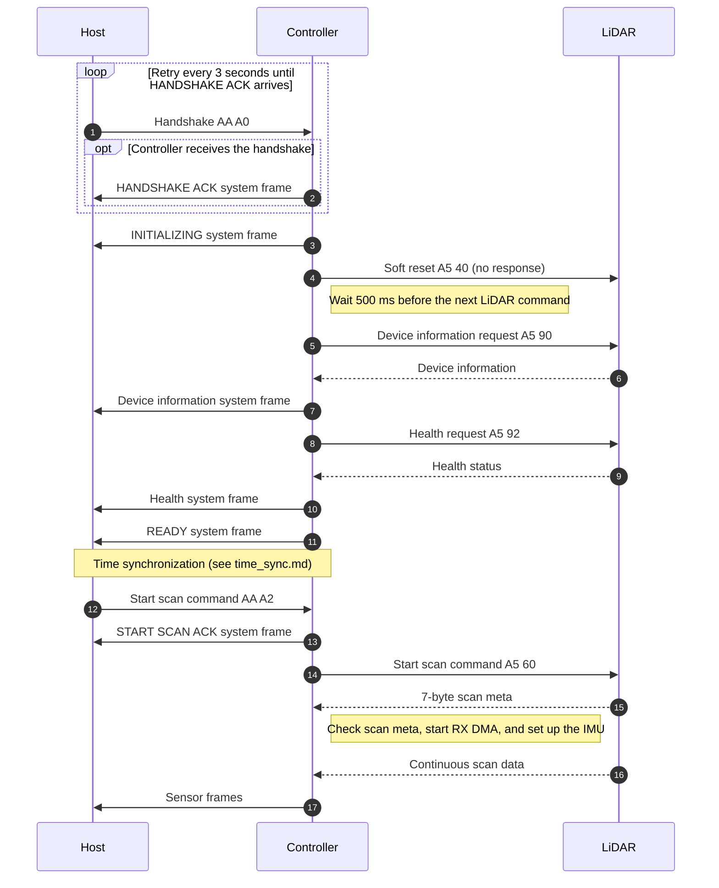
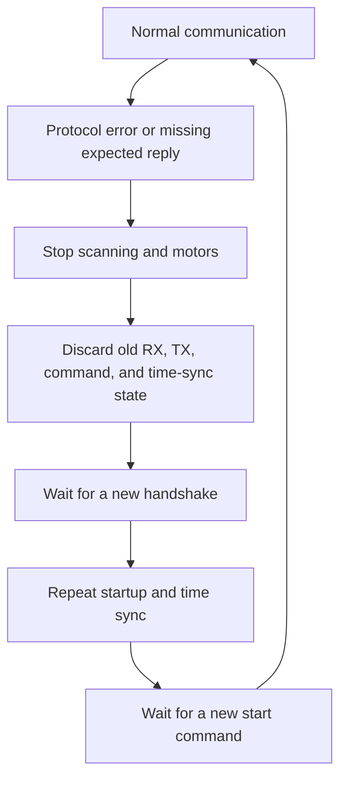
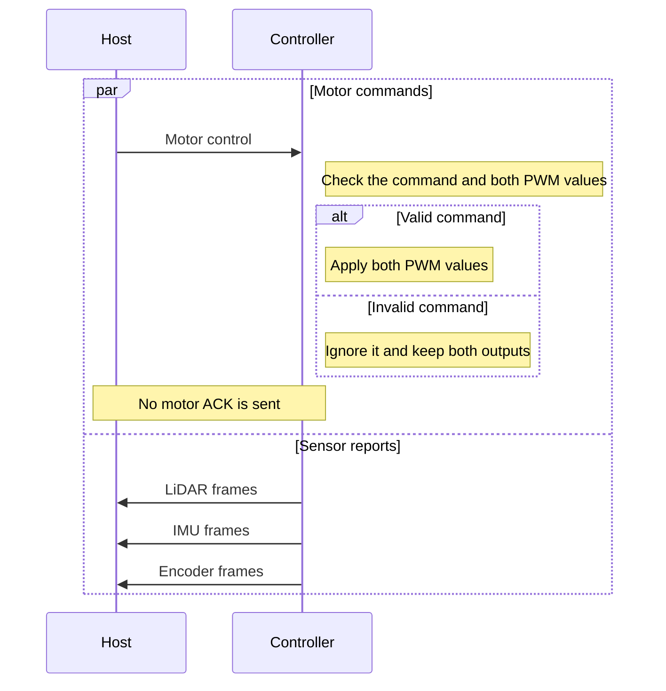

# Protocol

This document describes frame exchanges and recovery.
Command bytes and payloads are defined in [frame.md](frame.md).
Buffer management and DMA transfers are described in [arbiter.md](arbiter.md).
The time-sync exchange and calculation are described in [time_sync.md](time_sync.md).

## Connection and recovery

### Startup sequence

The host sends a handshake every 3 seconds until it receives `HANDSHAKE ACK`.
Initialization starts after this exchange. The handshake is a connection
request, not a heartbeat.

`START SCAN ACK` confirms the host command only. It does not confirm that LiDAR
or IMU setup has finished, or that the LiDAR has replied.
The controller checks device information and health before scanning.
After scanning starts, it sends no further LiDAR setup commands.

### Current recovery

| Event | Current action |
| --- | --- |
| Startup fails before `START SCAN ACK` is sent | Sends `STARTUP FAILED` when possible, then waits for a new handshake |
| Sending the LiDAR scan command, checking scan meta, or starting LiDAR DMA fails | Reports the stage when possible, then halts in `Error_Handler()` |
| Arming host command RX or setting up the IMU fails | Halts in `Error_Handler()`; no startup failure frame is sent for these failures |
| A LiDAR packet is invalid, times out, or is overwritten | Drops the current scan input; the host session continues |
| UART4 RX fails | Restarts LiDAR RX; the host session continues |
| A new handshake arrives during scanning | Does not restart the session |
| UART2 reports an error during scanning | No host RX recovery is implemented |
| Arming the next host receive fails | Halts in `Error_Handler()` |

After a startup retry, the host must repeat startup and time sync before
starting a new scan. The failure message format is defined in
[frame.md](frame.md#system-message).

Local LiDAR recovery keeps the host session and queued TX frames. It does not
repeat time sync or the startup exchange. Buffer resets and DMA restart steps
are described in [arbiter.md](arbiter.md#rx-recovery).

### Planned session recovery

The recovery below is not implemented. It would return an active host session
to handshake after a protocol error.

- Protocol errors would include failed UART transfers, invalid startup replies,
  malformed frames, incomplete commands after a timeout, and invalid time samples.
- A new handshake would end the previous session before `HANDSHAKE ACK`.
  The host would retry every 3 seconds until it receives the ACK.
- An accepted motor command would receive `MOTOR ACK`. A missing ACK would
  return the host to handshake.

## Motor commands

During normal communication, motor commands and sensor reports use separate
directions of the host UART.

An invalid motor command does not restart the handshake.
There is no motor-command watchdog. If no new command arrives, the last PWM
output stays active.

The command format and valid PWM range are defined in
[frame.md](frame.md#motor-control). Host receive-buffer handling is described in
[arbiter.md](arbiter.md#host-command-rx).
