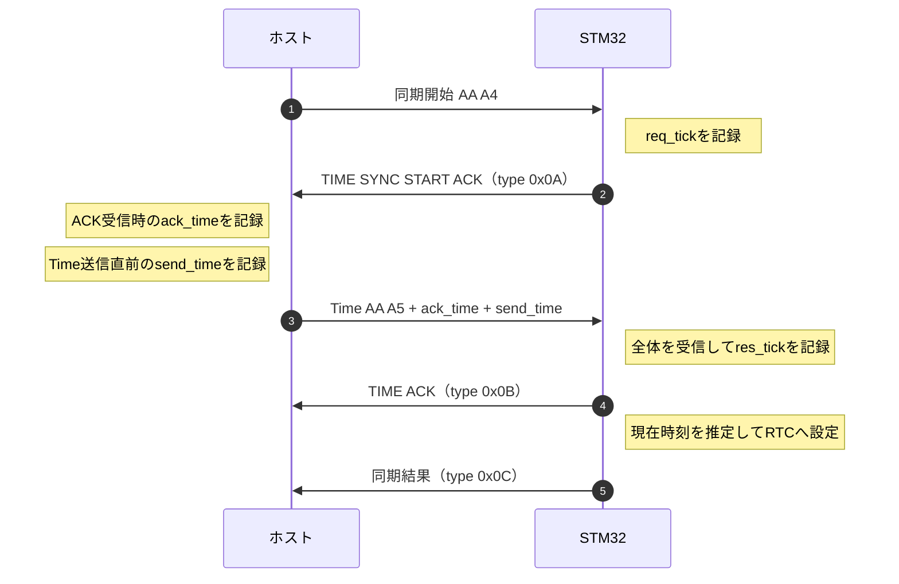

# 時刻同期

ホストの時刻を基準に、通信の遅れを見積もってSTM32のRTCを合わせる。
起動時に1回だけ行い、同期後の時刻はRTCが進める。
時計の進む速さを継続的に補正する仕組みは含まない。

## プロトコル



| 値 | 記録する側・タイミング | 単位と基準 |
| --- | --- | --- |
| `req_tick` | STM32が最初のACKを送る直前 | STM32の起動後ミリ秒 |
| `ack_time` | ホストがそのACKを受信したとき | Unixミリ秒（UTC） |
| `send_time` | ホストがTimeを送る直前 | Unixミリ秒（UTC） |
| `res_tick` | STM32がTime全体を受信した直後 | STM32の起動後ミリ秒 |

ホストからの同期開始は `AA A4` の2バイト。
Timeは次の18バイトで、各時刻は符号なし64bit・リトルエンディアンで送る。
どちらもTXヘッダや終端文字は付けない。

| バイト位置 | サイズ | 内容 |
| ---: | ---: | --- |
| `0` | 2バイト | `AA A5` |
| `2` | 8バイト | `ack_time` |
| `10` | 8バイト | `send_time` |

STM32からのACKと同期結果には、[共通のTXヘッダ](frame.md#tx-frame)が付く。
`TIME ACK` はTimeの受信確認で、RTCへの設定完了はその後に送る同期結果で確認する。
`TIME ACK` までのヘッダのtimestampは同期前のRTC値になる。

同期結果の本文は次のASCII文字列。末尾に `\r\n` を付け、NUL終端は送らない。
`samples=1` は1回の計測を使うことを表す。

```text
TIME SYNC: samples=1 | #1 req_tick=N ms res_tick=N ms round_trip=N ms ack_time=N ms send_time=N ms\r\n
```

`round_trip` は `res_tick - req_tick` で、ホストの処理時間も含んだ往復時間。

## アルゴリズム

計算はSTM32が行い、ホストから受け取った時刻と、自分のカウンタで測った経過時間を使う。

1. STM32は、自分がACKを送る直前から、ホストのTime全体を受信する直後までの経過時間を、
   `res_tick - req_tick` で求める。この往復時間には、ホスト内の処理時間も含まれる。
2. STM32は、ホストがACKを受信してからTimeを送るまでの処理時間を、
   `send_time - ack_time` で求める。STM32はこの値を往復時間から引き、往復の通信時間とみなす。
3. STM32は、ACKがSTM32からホストへ届く時間と、TimeがホストからSTM32へ届く時間を同じと仮定する。
   STM32は往復の通信時間を半分にして、TimeがホストからSTM32へ届くまでの時間を見積もる。
4. STM32は、ホストの送信時刻 `send_time` に、その片道時間を足して、自分がTimeを受信した時刻を推定する。
   さらにSTM32は、Timeの受信後から設定計算までに自分のカウンタが進んだ時間を足し、RTCに設定する時刻を求める。

以上を式にすると、STM32は次の値を計算する。`現在のtick` は、STM32が設定計算時に読むカウンタの値。

```text
往復時間         = res_tick - req_tick
ホストの処理時間 = send_time - ack_time
片道の通信時間   = (往復時間 - ホストの処理時間) / 2

STM32のTime受信時刻 = send_time + 片道の通信時間
RTCに設定する時刻  = STM32のTime受信時刻 + (現在のtick - res_tick)
```

例えばSTM32が往復を20ms、ホストの処理を4msと計算した場合、Timeの片道時間を `(20 - 4) / 2 = 8ms` と見積もる。
STM32がTimeを受信してから設定計算までにさらに5ms経っていれば、STM32はRTCに **`send_time + 13ms`** を設定する。
STM32は各計算を整数ミリ秒で行い、割り算の端数を切り捨てる。

STM32は、`send_time < ack_time`、ホストの処理時間が往復時間より長い、推定した日時がRTCの設定範囲外になるなど、
計測値が成立しない場合に同期を失敗として扱う。STM32は、RTCへの設定に失敗した場合も同期結果をホストへ送らない。

STM32からホストへ届く時間と、ホストからSTM32へ届く時間が異なると、STM32が推定した時刻に誤差が残る。
また、同期後にRTCがホストの時計より速く進めば、両者の時刻差は再び増える。
検証では、同期直後のRTCとホストの時刻差と、その後の経過時間に応じて増えた時刻差を分けて確認する。
