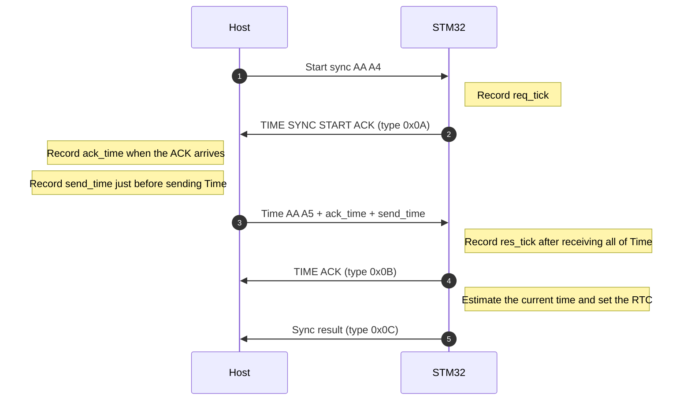

# Time Sync

The STM32 uses the host clock and an estimate of the communication delay to set its RTC.
This runs once at startup. The RTC keeps time after the sync.
The sync does not keep adjusting the clock rate.

## Protocol



| Value | Who records it and when | Unit and clock |
| --- | --- | --- |
| `req_tick` | STM32, just before sending the first ACK | Milliseconds since STM32 startup |
| `ack_time` | Host, when that ACK arrives | Unix milliseconds (UTC) |
| `send_time` | Host, just before sending Time | Unix milliseconds (UTC) |
| `res_tick` | STM32, just after receiving all of Time | Milliseconds since STM32 startup |

Command bytes and timestamp formats are defined in
[frame.md](frame.md#time-synchronization).

The ACKs and sync result from the STM32 use the [common TX header](frame.md#tx-frame).
`TIME ACK` only confirms that the STM32 received Time. The later sync result confirms that the RTC was set.
Header timestamps up to and including `TIME ACK` use the RTC time before the sync.

The sync result format is defined in [frame.md](frame.md#system-message).

`round_trip` is `res_tick - req_tick`. It includes the time spent processing on the host.

## Algorithm

The STM32 does the calculation. It uses the host timestamps and the elapsed time measured by its own counter.

1. The STM32 calculates `res_tick - req_tick` to get the time from sending its ACK to receiving all of Time.
   This round trip includes the host processing time.
2. The STM32 calculates `send_time - ack_time` to get the time the host spent between receiving the ACK and sending Time.
   The STM32 subtracts this host processing time from the round trip to get the communication time in both directions.
3. The STM32 assumes that the ACK and Time take the same time to travel in opposite directions.
   The STM32 divides the communication time by two to estimate the delay from the host to the STM32.
4. The STM32 adds that delay to `send_time` to estimate when it received Time.
   The STM32 then adds the time its counter has advanced since receiving Time to get the time to set in the RTC.

The STM32 calculates these values. `current_tick` is its counter value when it calculates the RTC time.

```text
round_trip      = res_tick - req_tick
host_processing = send_time - ack_time
one_way_delay   = (round_trip - host_processing) / 2

time_received = send_time + one_way_delay
rtc_time      = time_received + (current_tick - res_tick)
```

For example, if the STM32 measures a 20 ms round trip and 4 ms of host processing,
it estimates the delay as `(20 - 4) / 2 = 8 ms`.
If another 5 ms passes before the STM32 calculates the RTC time, it sets the RTC to **`send_time + 13 ms`**.
The STM32 uses whole milliseconds and rounds division down.

The STM32 treats the sync as failed if the values are not valid.
Examples include `send_time < ack_time`, host processing longer than the round trip, or a date outside the RTC range.
The STM32 also sends no sync result if it fails to set the RTC.

If the two directions have different delays, the estimated time still has an error.
If the RTC runs faster than the host clock after the sync, the time difference grows again.
When testing, check the time difference just after the sync separately from the drift that builds up later.
